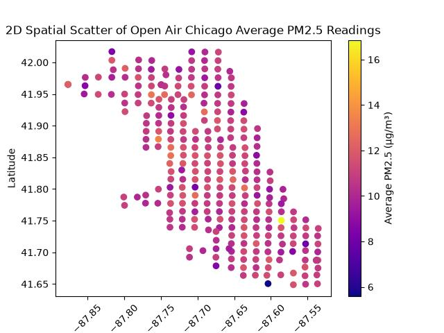

# Socioeconomic-Health-Disparities

UIC, CS 418: Introduction to Data Science, Fall 2026

## Group Members

- Anirudh Gupta
- Claudia Jimenez
- Andrew Mcclendon
- Auon Muhammad Naqvi
- Jesus Rodriguez

## Research Questions

- How is median household income associated with differences in air pollution exposure across Chicago community areas?
- Which demographics are effective for predicting high pollution levels?

## Primary Datasets

- Chicago_Community_Population (source: Chicago Health Atlas, https://chicagohealthatlas.org/indicators/INC)
- Open Air Chicago Day Aggregation (source: Chicago Data Portal, https://data.cityofchicago.org/Health-Human-Services/Open-Air-Chicago-Day-Aggregations/rtmx-vkjr/about_data) NOTE: Sample in data file is small subset of whole dataset, which is downloaded from API endpoint in EDA notebook.

## Secondary Datasets

- Chicago_Median_Income_By_Community (Chicago Data Portal: https://data.cityofchicago.org/Community-Economic-Development/ACS-5-Year-Data-by-Community-Area-Most-Recent-Year/7umk-8dtw/about_data)
- CommunityAreas_LocalEmission (source: Chicago Metropolitan Agency for Planning, (https://datahub.cmap.illinois.gov/datasets/communityareas-localemission2019/about)

We plan to compare the CommunityAreas_LocalEmission dataset to the primary Open Air Chicago Day Aggregation dataset to cross-check air quality levels over time and see which neighborhoods have the most greenhouse gas emissions as a measure of pollution.

## EDA Summary

Dataset basics:

- Chicago Community Population Data: contains Chicago community areas and demographics. No null values. Analyzed number of households per community area by income bracket.
- Open Air Chicago Day Aggregations: Contains daily aggregated data since September 2025 to present from environmental sensors in various locations in and around Chicago. Investigated distributions of PM 2.5 and NO2 readings and aggregated by sensor name.
- Joined Open Air sensors with community areas and removed sensors outside of Chicago
- Community Area Local Emission dataset: Analyzed on-road CO2 emissions across Chicago community areas.
- Income dataset: Compared against mean PM 2.5 concentration from Open Air Chicago dataset.

Anomaly notes:

- The Open Air Chicago dataset contained many null values, several of which were caused by offline sensors. Irrelevant columns and rows with null values were dropped. Sensor calibration should also be investigated further.

Significant findings:

- Preliminary analysis shows most of the sensors with the highest and lowest readings are located on Chicago's South and West sides. More investigation is warranted to find any other correlations between area and air pollution.
- Preliminary analysis shows little to no linear correlation between median household income and average PM 2.5 exposure. Further investigation is likely needed.

Research questions: Our research questions may need to change in the future based on our EDA findings, especially the lack of a linear correlation between income and air quality.

Ideas:
Revised RQ1: Does household income relate more to steady, everyday PM2.5 levels or to short pollution spikes across Chicago's community areas?
Revised RQ2: Does being near industrial sites and transportation corridors predict pollution spikes better than income alone?

## Data Documentation

- **Datasheet:** [Read our complete DATASHEET.md here](DATASHEET.md)
- **Dataset 1:** [Open Air Chicago Day Aggregations](https://data.cityofchicago.org/Health-Human-Services/Open-Air-Chicago-Day-Aggregations/rtmx-vkjr/about_data) (Source: Chicago Data Portal. License: Chicago Open Data Terms of Use at https://www.chicago.gov/city/en/narr/foia/data_disclaimer.html).
- **Dataset 2:** [Chicago Community Population](https://chicagohealthatlas.org/indicators/POP) (Source: Chicago Health Atlas. License: Public Domain / Open Data).

**Terms of Use for Open Air Chicago dataset:** This site provides applications using data that has been modified for use from its original source, www.cityofchicago.org, the official website of the City of Chicago.  The City of Chicago makes no claims as to the content, accuracy, timeliness, or completeness of any of the data provided at this site.  The data provided at this site is subject to change at any time.  It is understood that the data provided at this site is being used at one’s own risk.

**Limitations:** The Open Air Chicago dataset measures outdoor neighborhood-level air quality on municipal utility poles, which does not equal an individual resident's direct personal exposure. Additionally, the daily aggregation of sensor data may hide short-duration, high-intensity localized pollution spikes, and Chicago Community Population estimates are subject to ACS sampling uncertainty.

## Main Findings (Narrative Analysis)
* There is no evidence of linear correlation between average PM2.5 readings by Open Air Chicago sensors and latitude or longitude.

The Pearson correlation coefficient, listed as r in the table below, when plotting latitude against the average PM2.5 reading per sensor was 0.0115 with a p-value of 0.8461 and a 95% confidence interval of `[-0.1046, 0.1273]`. The Pearson correlation coefficient when plotting longitude against average PM2.5 reading was -0.0494 with a p-value of 0.4054 and a 95% confidence interval of `[-0.1644, 0.0670]`. Both r values are very close to 0, and both confidence intervals include 0, showing no statistically significant linear correlation between average PM2.5 and either latitude or longitude. This supports our EDA findings, which showed that the highest and lowest PM2.5 readings came from a mix of sensors on the north, west, and south sides of Chicago. These findings are supported by the 2D spatial scatterplot below, with each dot as one sensor with latitude plotted against longitude. There is not one singular trend of average PM2.5 increasing or decreasing as you travel north/south or east/west across the city, with most of the sensors across the city showing average PM2.5 readings near the middle of the range. The scatterplots of latitude vs average PM2.5 and longitude vs PM2.5 are also included in my [narrative analysis notebook](Narrative Analysis/Claudia_analysis.ipynb). I wanted to test if there was any correlation between increased PM2.5 air pollution and sensors further west or further south. These results may be confounded by Chicago’s sprawling layout and non-rectangular shape, along with the fact that major highways and transportation corridors, such as I-90/I-94 and the Chicago River, go diagonally across the city. One proposed check would be to calculate the distance between sensors with high or low PM2.5 or NO2 readings and major industrial hubs or transportation corridors. 

| x         | y             | r       | p-value | 95% CI              |
|-----------|---------------|---------|---------|---------------------|
| Latitude  | Average PM2.5 | 0.0115  | 0.8461  | `[-0.1046, 0.1273]` |
| Longitude | Average PM2.5 | -0.0494 | 0.4054  | `[-0.1644, 0.0670]` |

